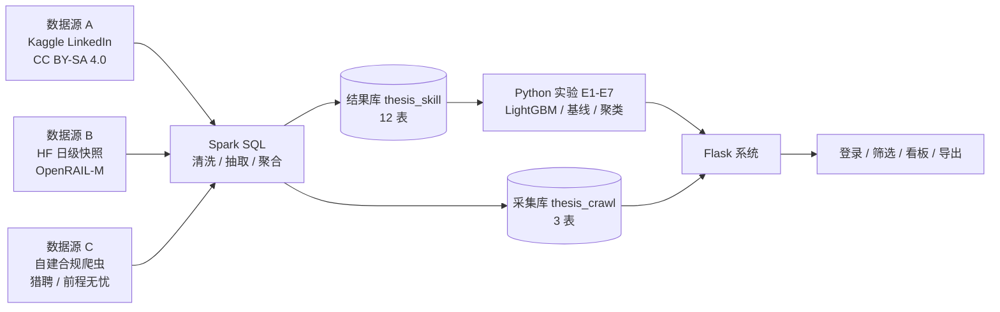
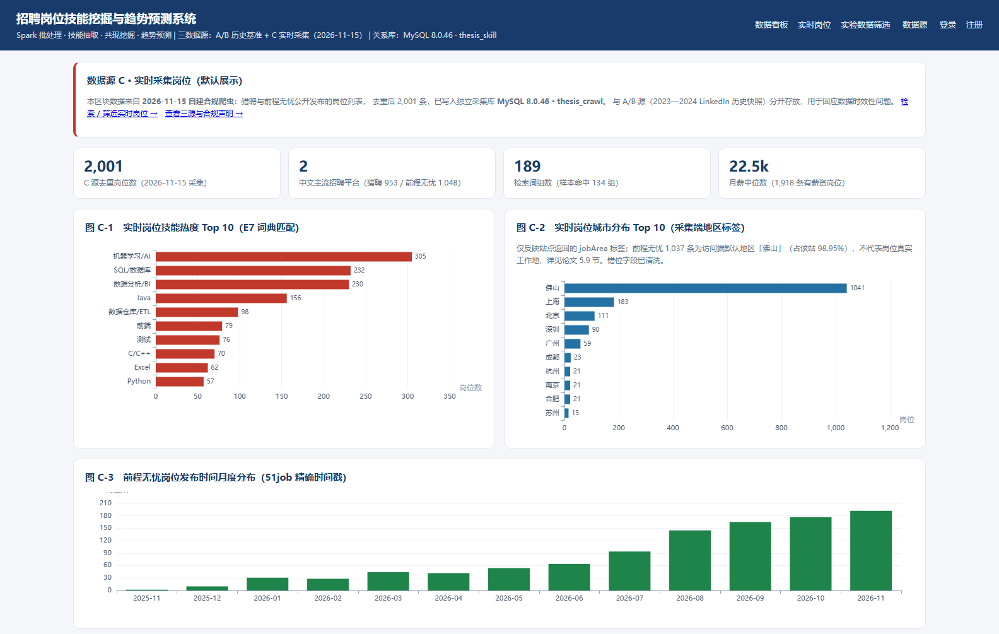
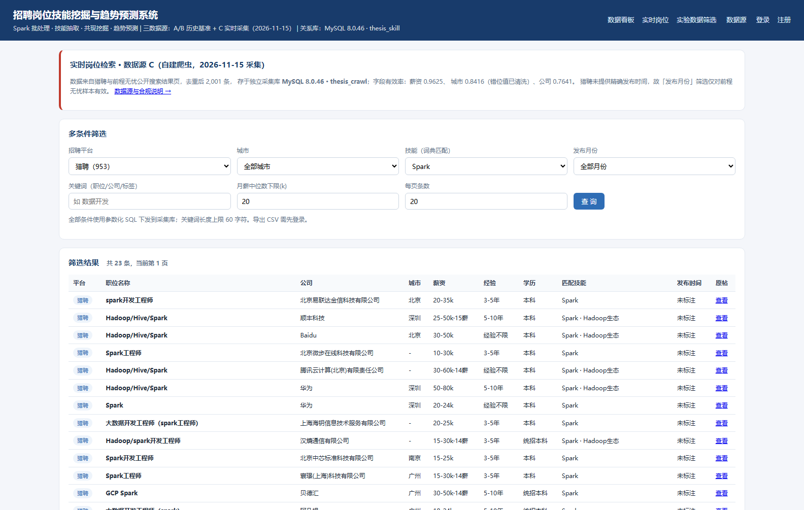
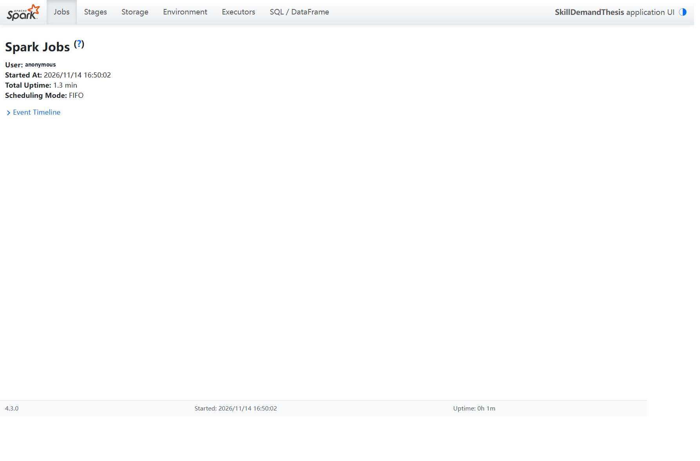

# 招聘岗位技能挖掘与趋势预测系统

> 本科毕业设计配套工程仓库：**Spark 批处理 + 多算法趋势预测 + Flask 可视化系统**。
> 对应论文《基于Spark的招聘岗位技能挖掘与趋势预测系统的设计与实现》，
> **论文正文、答辩 PPT 与原始数据集不在本仓库公开**，这里只放代码、实验结果与界面截图。

维护者：SparkJobSkills Contributors（匿名开源版） · 2026

---

## 为什么值得看

| 维度 | 做了什么 |
|---|---|
| **数据管线** | 三源并用：公开数据集 A/B 做主实验，自建合规爬虫 C 做时效性验证；Spark SQL 完成清洗、技能聚合与一致性校验 |
| **算法实验** | E1 技能抽取三方法 P/R/F1 对比、E2 KMeans + FPGrowth 共现、E3 六模型滚动原点预测、E4 千万行可扩展性 |
| **工程系统** | Flask 登录注册、两级角色权限、参数化 SQL、组合筛选、CSV 导出、ECharts 可视化；SQLite / MySQL 8 双后端同一套业务代码 |
| **可复现** | E0–E7 全部结果以 CSV 落盘，图表与截图随仓库提供，SQLite 后端开箱即用 |
| **学术诚实** | 数据许可、合规边界、字段噪声与地区标签偏差全部显式披露，见 `NOTICE.md` |

---

## 架构



C 源单独建库，与 A/B 主实验结果库隔离，避免把实时采集数据混入论文实测口径。

## 技术栈

Python 3.13 · PySpark 3.5+ / JDK 17 · pandas · scikit-learn · LightGBM ·
Flask 3 · SQLite / MySQL 8.0.46 · ECharts · Chrome DevTools Protocol（仅公开页面渲染）

## 快速开始（无需 MySQL）

```bash
git clone https://github.com/dyc94588/spark-job-skills-public.git
cd spark-job-skills-public
python -m venv .venv && .venv\Scripts\activate      # Linux/macOS: source .venv/bin/activate
pip install -r experiments/requirements.txt

python experiments/system/init_db.py                  # 建结果库 + 演示账号
python experiments/system/app.py                     # 默认 SQLite 后端
# 浏览器打开 http://127.0.0.1:5000
```

演示账号与口令在 `.env.example` 中，可用环境变量覆盖，也可直接在 `/register` 注册。
切换到 MySQL：`cp experiments/system/mysql_config.example.json experiments/system/mysql_config.json`
填入自己的本机口令，然后 `THESIS_DB_BACKEND=mysql python experiments/system/app.py`。

### 关于 C 源实时看板

C 源 2,001 条岗位的原始卡片与全量 CSV **因数据许可与个人信息不予公开**。
仓库提供 3 条完全虚构的 `experiments/data/real/source_c/jobs_c.example.csv`，
系统首次访问时会**自动**从该示例构建采集库，因此 clone 下来零配置即可打开首页看板
（页面会提示当前为演示样本）。

需要换成自己合规采集的数据时：把结果命名为 `jobs_c.csv` 放到同目录，
删除 `experiments/system/data/source_c.db` 后刷新页面即可；
MySQL 后端则额外执行一次 `python experiments/system/init_source_c_db.py`。

**真实的 E7 统计结果**以 `experiments/results/e7_*.csv` 与 `figures/` 中的图为准，
看板中的示例岗位不参与任何结论。需要完整 2,001 条时，请按 `NOTICE.md` 的合规边界自行采集。

---

## 实验结果速览

| 实验 | 内容 | 关键结果 |
|---|---|---|
| E1 | 技能抽取三方法对比 | 加权词典+否定过滤 F1 0.3128；LSA 语义扩展 F1 **0.3338**（R 0.4589） |
| E2 | KMeans 聚类 + FPGrowth 关联规则 | 聚类轮廓与规则提升度见 `e2_*.csv` |
| E3 | 6 模型 × 3 预测步长，滚动原点验证 | 全体 WAPE：朴素基线 0.3590 / 3 期移动平均 0.3732 / LightGBM 差分目标 0.3861（短 horizon 下基线仍有竞争力，未强行宣称主模型全胜） |
| E4 | 10 万 / 100 万 / 1000 万行可扩展性 | 1000 万行 Spark 0.688 s vs pandas 1.765 s，加速 **2.5645×**；聚合组数一致 |
| E5 | 系统功能测试 T01–T10 | 登录、注册、权限、筛选、导出、接口逐项实测 |
| E6 | MySQL 8 导入 / 完整性 / 索引 / 并发 / 安全 | 10/10 结果表一致；复合索引后查询 15.1368 → 2.0884 ms（**7.2481×**），EXPLAIN 扫描行 110,592 → 16,668 |
| E7 | 自建合规爬虫 C 源迁移验证 | 2,001 条去重岗位 / 189 组检索词；Spark 与 pandas 技能频次 **Top15 完全一致**；月薪中位数 22.5k |

完整凭证在 `experiments/results/`，图表在 `figures/`，实跑界面在 `screenshots/`。

## 界面预览

| 首页实时看板 | 岗位检索 | Spark UI |
|---|---|---|
|  |  |  |

## 目录结构

```
experiments/
  real_pipeline/     E1-E7 真实数据实验脚本（r00-r07、公共口径、技能词典）
  crawler/           合规爬虫与可达性探测（含风控停采留痕）
  system/            Flask 系统、双后端适配层、模板、初始化脚本
  results/           E0-E7 全部结果 CSV
  data/real/         原始数据目录（仅保留说明与虚构示例，真实数据不公开）
figures/             论文图表 16 张
screenshots/         系统实跑截图 6 张
docs/                架构、复现步骤、推送检查清单
NOTICE.md            数据许可与合规声明
```

## 已知限制

- C 源的 `jobArea` 为采集端默认地区标签（前程无忧 98.95% 为「佛山」），**不代表真实工作地**，不作地区差异推断；`city` 字段另有约 300 条猎头顾问姓名错位，已用规则清洗列 `city_n` 处理，原始列保留作溯源凭证。
- A/B 源时间跨度不同：A 约 5 个月、B 36 个有效观测月；趋势预测仅由 B 提供，A 用于技能抽取评测。
- 非 Windows 平台运行截图 / 爬虫脚本时，需设置 `CHROME_PATH` 或修改脚本中的 Chrome 路径常量。
- 本仓库不含论文正文与原始数据集，完整复现需要先自行按许可获取 A/B 数据，步骤见 `docs/REPRODUCE.md`。

## 许可

代码：MIT，见 `LICENSE`。数据、图表与第三方库：见 `NOTICE.md`（**不对原始数据作任何再分发授权**）。
